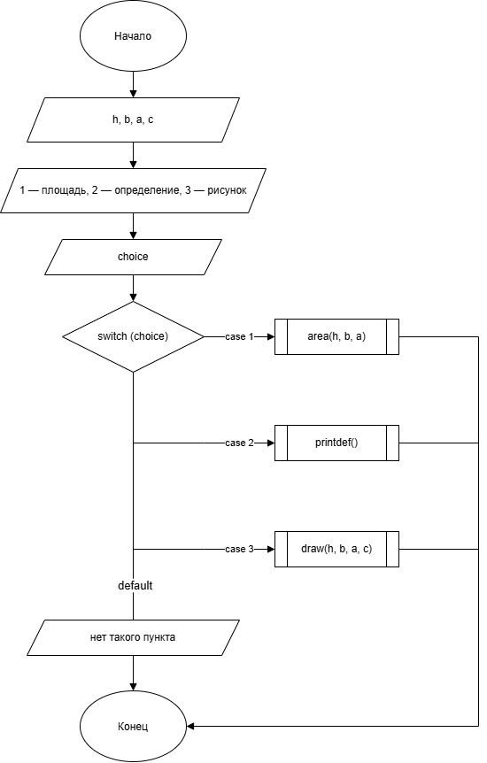
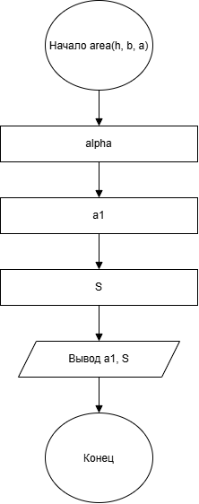
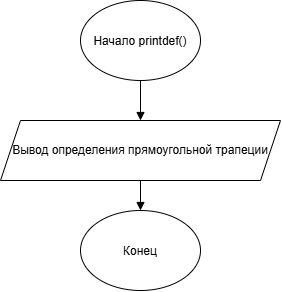
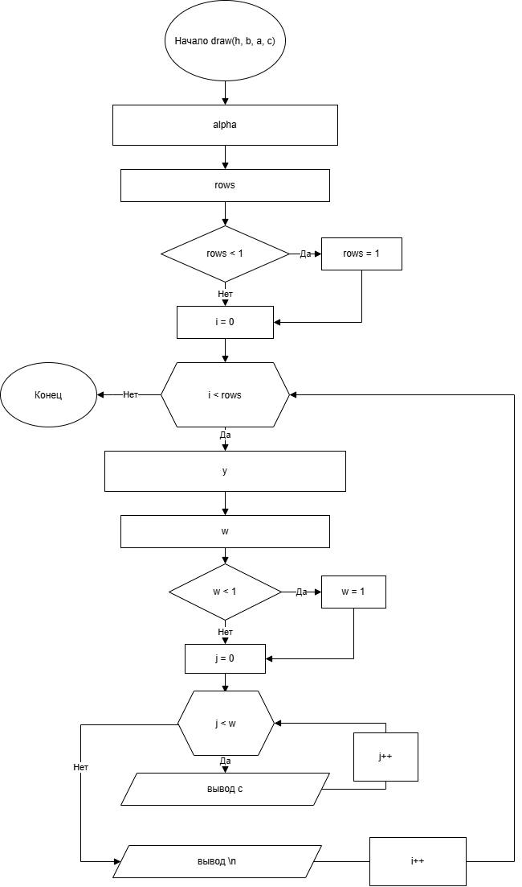

# Домашнее задание к работе номер 10

## Условие задачи

Составьте программу, которая для заданной пользователем фигуры, например прямоугольника (треугольника или другой фигуры см. инидивидуальное задание работы 9) предлагает меню выбора одной из операций.

## 1. Алгоритм и блок-схема

### Алгоритм

1. Начало.

2. Объявить переменные:
 \
**c** - символ для фигуры\
**h** - высота\
**b** - верхнее основание трапеции\
**a** - угол

3. Вывести меню выбора.

4. С помощью функций и оператора switch реализовать возможность получения площади фигуры, её определения и рисунка.

5. Конец.

### Блок-схема

\
\
\


## 2. Реализация программы

```c
#define _CRT_SECURE_NO_WARNINGS
#include <stdio.h>
#include <math.h>
#include <locale.h>

#define M_PI 3.14159265358979323846

// площадь
void area(double h, double b, double a)
{
    double alpha = a * M_PI / 180.;
    double a1 = b + h / tan(alpha);
    double area = (a1 + b) / 2. * h;

    printf("Нижнее основание = %.2lf\n", a1);
    printf("Площадь S = %.2lf\n", area);
}

// определение
void printdef(void)
{
    printf("Прямоугольная трапеция - это трапеция, у которой одна боковая сторона перпендикулярна основаниям (два угла равны 90 градусов).\n");
}

// рисование
void draw(double h, double b, double a, char c)
{
    double alpha = a * M_PI / 180.;
    double ctg = 1.0 / tan(alpha);
    int rows = (int)(h + 0.5);
    if (rows < 1) rows = 1;

    for (int i = 0; i < rows; i++) {
        double y = (rows > 1) ? (double)i * h / (rows - 1) : 0;
        int w = (int)(b + y * ctg + 0.5);
        if (w < 1) w = 1;

        for (int j = 0; j < w; j++)
            putchar(c);
        putchar('\n');
    }
}

int main(void)
{
    setlocale(LC_CTYPE, "RUS");
    double h, b, a;
    char c;
    int choice;

    printf("Высота: ");
    scanf("%lf", &h);

    printf("Верхнее основание: ");
    scanf("%lf", &b);

    printf("Угол: ");
    scanf("%lf", &a);

    printf("символ: ");
    scanf(" %c", &c);

    printf("\n===========\n");
    printf("1) Рассчитать площадь\n");
    printf("2) Вывести определение фигуры\n");
    printf("3) Нарисовать фигуру\n\n");
    scanf("%d", &choice);

    switch (choice) {
        case 1: area(h, b, a); break;
        case 2: printdef(); break;
        case 3: draw(h, b, a, c); break;
        default: printf("нет такого пункта\n"); break;
     }
    return 0;
}
```

## 3. Результаты работы программы

Пример:\
 \
Высота: 5\
Верхнее основание: 2\
Угол: 30\
символ: *

===========

1) Рассчитать площадь

2) Вывести определение фигуры

3) Нарисовать фигуру

1\
Нижнее основание = 10.66\
Площадь S = 31.65

## 4. Информация о разработчике

Литуновский Максим Дмитриевич, бТИИ-261
